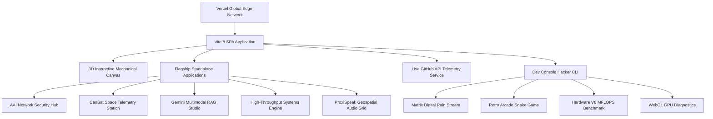

# Dev Jangid — Interactive 3D Mechanical Terminal & Engineering Portfolio

<div align="center">

[](https://dev-jangid-portfolio.vercel.app)
[](https://react.dev/)
[](https://www.typescriptlang.org/)
[](https://vitejs.dev/)
[](https://tailwindcss.com/)
[](https://opensource.org/licenses/MIT)

**[Explore Live Portfolio](https://dev-jangid-portfolio.vercel.app)** • **[Direct ATS Resume PDF](https://dev-jangid-portfolio.vercel.app/resume.pdf)** • **[GitHub Profile](https://github.com/Dev-5678)**

</div>

---

## 🌟 Overview

High-performance, interactive portfolio and system telemetry station for **Dev Jangid** (Computer Science Engineer specializing in Enterprise Systems, Aerospace Telemetry, and Multimodal Artificial Intelligence). Built with an obsidian and ember aesthetic, featuring:

- ⌨️ **Interactive 3D Mechanical Terminal Keyboard**: Realistic vector SVG keycaps (`C`, `Java`, `React`, `Git`, `OS`, `SQL`), touch and mouse orbit camera controls, and Web Audio API synthesized mechanical keystroke acoustics.
- 🚀 **5 Full-Stack Standalone Web Applications**:
  1. **AAI Network Security & IT Infrastructure**: VLAN 101 ANS airside isolation, stateful packet inspection, high-availability MySQL database clustering, and live flight radar tracking.
  2. **CanSat & CubeSat Space Telemetry System**: 1U space payload collecting atmospheric lapse rates, 433.92 MHz UHF FSK radio frequency packet decoding with CRC-16 checksums, and descent triggers.
  3. **Multimodal Generative AI & RAG Engine**: Google Cloud Vertex AI & Gemini 1.5 Pro inference engine with dense 768-dimensional vector embeddings and cosine similarity search.
  4. **High-Throughput Low-Latency Systems Engine**: In-place QuickSort partitioning, flat min-heap Dijkstra routing, and Robin Hood open-addressing hash maps.
  5. **ProxiSpeak Geospatial Audio Ecosystem**: Real-time 2D spatial audio communication grid calculating dynamic inverse-square Euclidean distance attenuation and stereo panning across virtual coordinate maps.
- ⚡ **Live Dynamic GitHub Telemetry**: Automated live data fetching from GitHub API (`@Dev-5678`), tracking public repositories, daily commit streaks, and verified language breakdowns with client-side cache protection.
- 🕹️ **Dev Console (` ` ` / Ctrl+K)**: Built-in hacker terminal equipped with playable retro arcade Snake, green Matrix digital rain stream, V8 hardware compute benchmarks (MFLOPS), client GPU diagnostics, and CLI shortcuts.
- 📄 **ATS-Compliant Resume System**: Integrated in-app interactive modal with 1-click verified PDF download (`/resume.pdf` & `/Dev_Jangid_Resume.pdf`).
- 📈 **Real-Time Observability**: Vercel Analytics and Speed Insights tracking global visitor origins and Core Web Vitals.

---

## 🏗️ Architecture & Subsystem Layout



---

## 🛠️ Tech Stack & Tooling

| Domain | Technology Stack |
| :--- | :--- |
| **Frontend Core** | React 19, TypeScript 6, Vite 8, Tailwind CSS v4 |
| **3D & Canvas** | HTML5 Canvas, Responsive Camera Zoom, Matrix Rain Engine |
| **Audio Synthesis** | Web Audio API (OscillatorNode, GainNode, StereoPannerNode) |
| **APIs & Data** | GitHub REST API, WebSockets / Socket.io, Real Northern India Flight Radar |
| **Observability** | `@vercel/analytics`, `@vercel/speed-insights` |
| **Testing & CI** | Vitest, GitHub Actions, Oxlint |
| **Hosting & CDN** | Vercel Anycast Edge Network (`bom1` Mumbai Node) |

---

## 💻 Local Development

### Prerequisites
- Node.js `v20+` or `v24+`
- npm `10+`

### Setup
```bash
# Clone the repository
git clone https://github.com/Dev-5678/dev-jangid-portfolio.git
cd dev-jangid-portfolio

# Install dependencies
npm install

# Start local development server
npm run dev
```
Open `http://localhost:5173` in your browser.

### Verification & Testing
```bash
# Type check TypeScript definitions
npx tsc --noEmit

# Run unit tests
npm test

# Build production bundle
npm run build
```

---

## 🎮 Interactive Terminal Shortcuts

While browsing the portfolio, open the Developer Console by pressing the backtick key (`` ` ``) or typing `Ctrl+K`:

```bash
dev@jangid:~$ help
dev@jangid:~$ proxispeak   # Inspect spatial audio ecosystem
dev@jangid:~$ matrix       # Launch green digital rain canvas
dev@jangid:~$ snake        # Play retro arcade snake minigame
dev@jangid:~$ benchmark    # Stress test V8 engine & CPU MFLOPS
dev@jangid:~$ sysinfo      # Inspect client GPU vendor & telemetry
dev@jangid:~$ resume       # Download official ATS resume PDF
dev@jangid:~$ sudo hire    # Open priority recruiter dispatch
```

---

## 📄 License

This project is open-source and released under the [MIT License](LICENSE).
Built with passion by **[Dev Jangid](https://github.com/Dev-5678)**.
